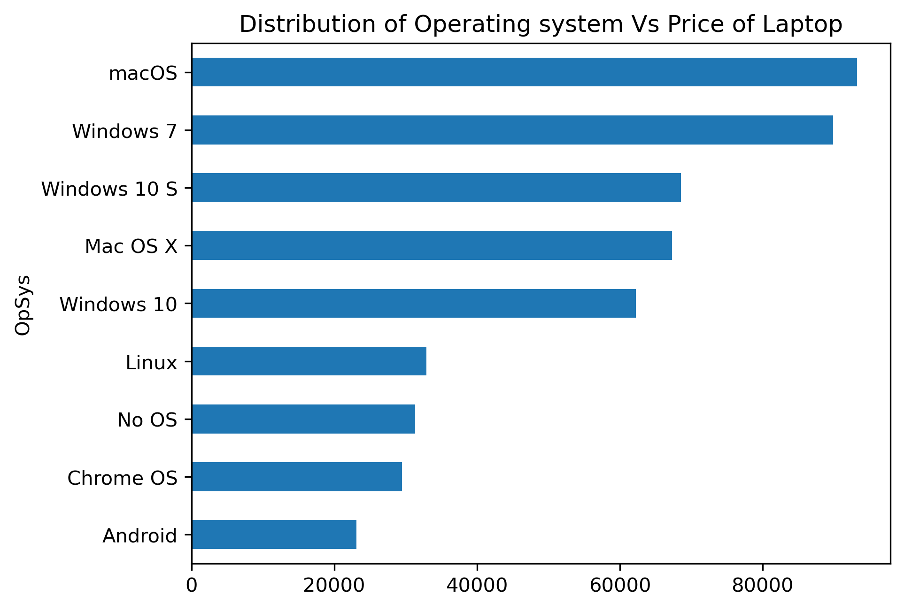
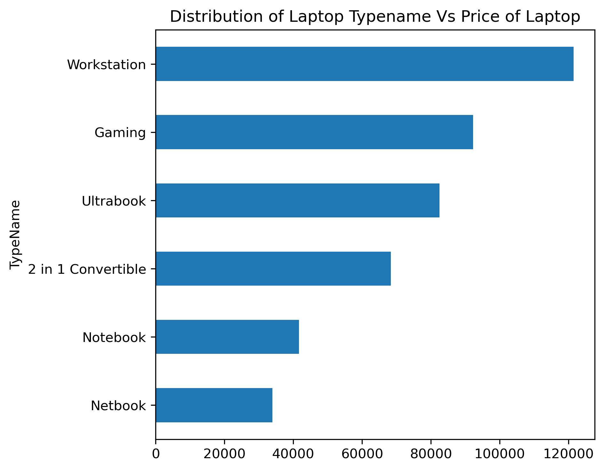
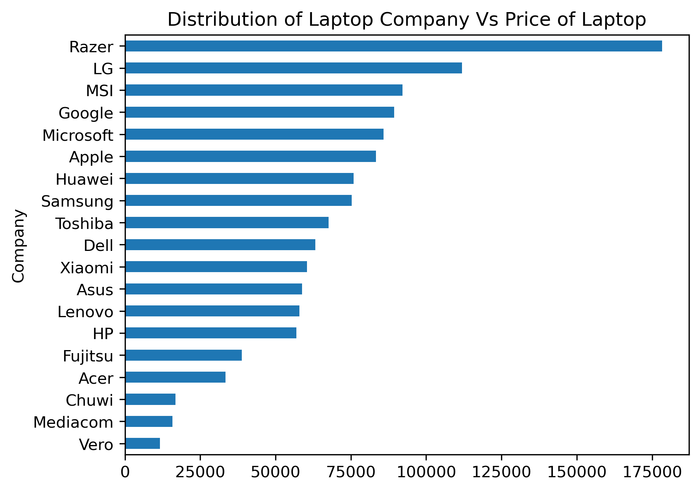
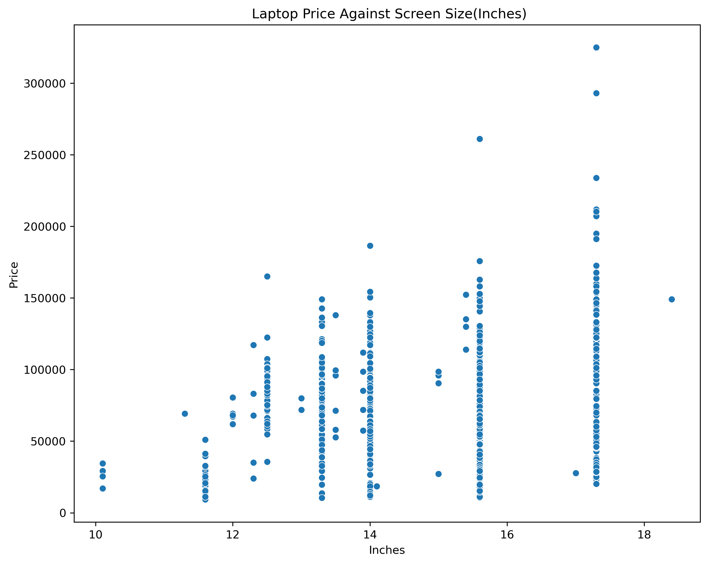
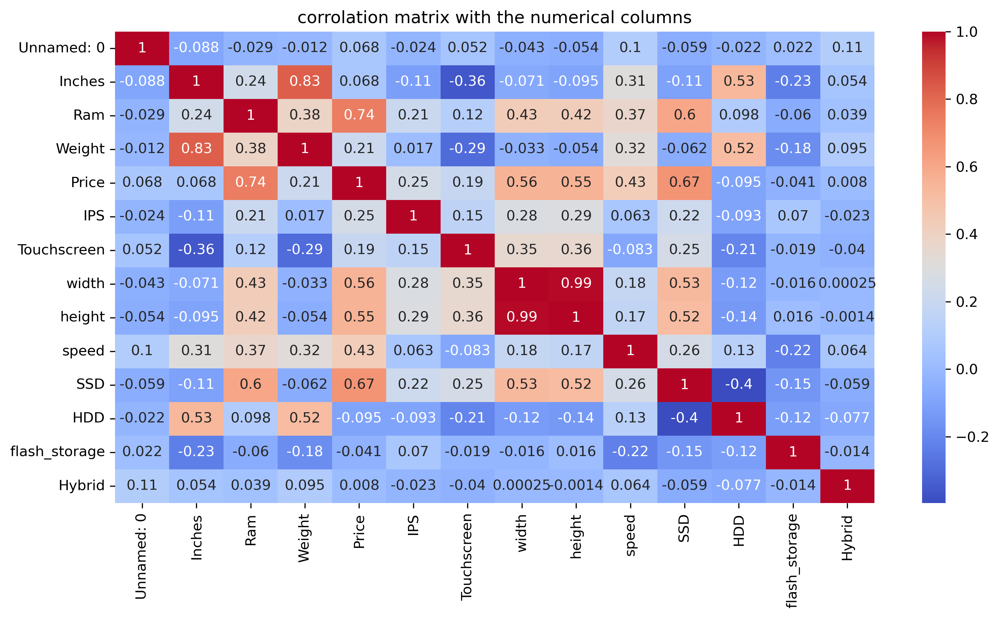
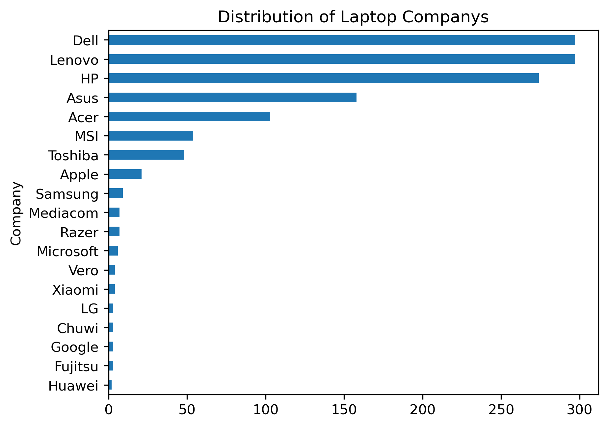

# Laptop Price Prediction Using Machine Learning

Predicting laptop prices from their specifications (brand, operating system, GPU, screen resolution, memory and CPU) using **Multiple Linear Regression**, **Decision Tree Regression** and **Random Forest Regression**.

**Author:** Ibialabo Dappa
**Report date:** 16 July 2026

---

## Overview

Laptop prices vary widely across brands and configurations, which makes it hard for buyers and retailers to know what a fair price is. This project analyses how hardware features and brand affect price, then builds regression models that predict the price of a laptop from its specifications.

The final models can support data-driven pricing for manufacturers and small and medium-sized laptop retailers.

## Dataset

- **Source:** Kaggle (CSV format)
- **Size:** 1,303 rows and 12 columns
- **Data quality:** no missing values, nulls or duplicates
- **Target variable:** `Price`
- **Original columns:** Company, TypeName, Inches, ScreenResolution, Cpu, Ram, Memory, Gpu, OpSys, Weight, Price

After feature engineering and encoding, the data was split 80/20:

| Set | Rows | Columns |
|---|---|---|
| X_train | 1,042 | 57 |
| X_test | 261 | 57 |

## Feature Engineering

| Original column | Engineered features |
|---|---|
| ScreenResolution | `width`, `height`, `Touchscreen`, `IPS` |
| Cpu | `cpu_brand_name`, `speed` (GHz) |
| Gpu | `Gpu_brand` |
| Memory | `SSD`, `HDD`, `flash_storage`, `Hybrid` (GB) |

The original `ScreenResolution`, `Cpu`, `Gpu` and `Memory` columns were dropped after extraction. Categorical variables (Company, TypeName, OpSys, cpu_brand_name, Gpu_brand) were one-hot encoded, and label encoding was tested as a comparison.

## Exploratory Data Analysis

Key findings:

- **Brands:** Dell, Lenovo and HP dominate the dataset. Razer has by far the highest average price, while Vero, Mediacom, Chuwi and Acer sit at the budget end.
- **Operating system:** macOS and Windows 7 have the highest average prices. Linux, No OS, Chrome OS and Android have the lowest.
- **Laptop type:** Workstation and Gaming laptops are the most expensive. Notebooks and Netbooks are the cheapest.
- **Screen size:** a weak predictor of price on its own, with wide price spread at every size.
- **Correlation with price:** RAM (0.74) and SSD (0.67) are the strongest numerical predictors, followed by screen width/height (about 0.55) and CPU speed (0.43).








## Methodology

1. Clean and explore the data
2. Engineer features from compound columns
3. Encode categorical variables (one-hot vs label encoding comparison)
4. Split the data 80% train / 20% test
5. Train three regression models inside Scikit-learn `Pipeline`s to keep preprocessing consistent and avoid data leakage
6. Improve the models step by step:
   - **Dummy variable encoding** (`drop="first"`) to reduce one-hot multicollinearity. Predictive accuracy did not change, but coefficients are easier to interpret.
   - **Removed `height`**, since it is almost perfectly correlated with `width` (0.99).
   - **Log-transformed the target**, using `log(1 + Price)`, to fix the right-skewed price distribution. This gave the biggest improvement.
7. Evaluate with MAE, RMSE and R²

## Results

### Baseline (original price, one-hot encoded)

| Model | MAE | RMSE | R² |
|---|---|---|---|
| Linear Regression | 12,429.52 | 17,902.61 | 0.7777 |
| Decision Tree | 13,079.62 | 19,913.70 | 0.7250 |
| Random Forest | 10,243.74 | 16,673.12 | 0.8072 |

### Final (log-transformed price, one-hot encoded)

| Model | MAE (log scale) | RMSE (log scale) | R² |
|---|---|---|---|
| Linear Regression | 0.189 | 0.239 | 0.8387 |
| Decision Tree | 0.221 | 0.304 | 0.7388 |
| **Random Forest** | **0.166** | **0.222** | **0.8604** |

> MAE and RMSE in the final table are in log units, so they cannot be compared directly with the baseline. R² is comparable across both tables.

## Key Findings

- **Random Forest** was the best model at every stage, reaching **R² = 0.8604**.
- **Linear Regression** gained the most from the log transformation (R² from 0.778 to 0.839), narrowing the gap with Random Forest to about two percentage points. It is a good option when interpretability matters.
- **Decision Tree** overfit and performed worst after the transformation.
- **One-hot encoding** worked better than label encoding for Linear Regression (0.778 vs 0.721). Tree-based models were barely affected.
- **RAM, SSD, brand, laptop type and operating system** are the main drivers of price. Screen size matters little by itself.

## Tech Stack

- Python 3.x
- pandas, NumPy
- Matplotlib / Seaborn
- scikit-learn
- Jupyter Notebook

## Installation

```bash
git clone https://github.com/<your-username>/laptop-price-prediction.git
cd laptop-price-prediction
pip install -r requirements.txt
```

## Usage

```bash
jupyter notebook laptop_price_prediction.ipynb
```

## Repository Structure

```
├── data/                  # Laptop dataset (CSV)
├── notebooks/             # Jupyter notebook
├── images/                # Charts and figures
├── report/                # Technical report (PDF)
├── requirements.txt
└── README.md
```

## Limitations and Future Work

- Tune hyperparameters (for example, limit Decision Tree depth and tune Random Forest)
- Try Gradient Boosting or XGBoost
- Use a larger and more recent dataset, since laptop prices change over time
- Deploy as a simple web app where users enter specs and get a price estimate

## References

- Breiman, L. (2001). Random Forests. *Machine Learning*, 45(1), 5–32. https://doi.org/10.1023/A:1010933404324
- Scikit-learn Developers. RandomForestRegressor documentation. https://scikit-learn.org/stable/modules/generated/sklearn.ensemble.RandomForestRegressor.html
- Potdar, K., Pardawala, T. S., & Pai, C. D. (2017). A Comparative Study of Categorical Variable Encoding Techniques for Neural Network Classifiers. *International Journal of Computer Applications*, 175(4), 7–9. https://doi.org/10.5120/ijca2017915495

## Contact

**Ibialabo Dappa**: Data Analyst | Data Scientist
Email: ibialabodappa@gmail.com

